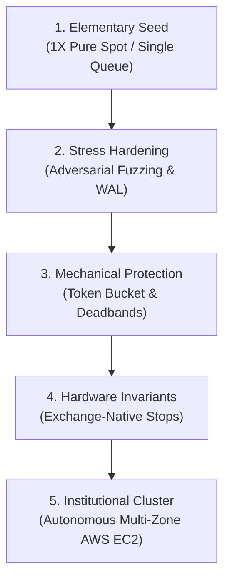

# 🏛️ THE DUAL DOCTRINE OF REHAN QUANT LAB
### *Stealth Sophistication & Gall's Evolutionary Law*

---

> ### **I. Sun Tzu on Strategic Asymmetry**
> *"All warfare is based on deception. When strong, appear weak. When near, make them believe you are far. When far, make them believe you are near."*  
> — **Sun Tzu**, *The Art of War*

> ### **II. John Gall on Systems Engineering**
> *"A complex system that works is always found to have evolved from a simple system that worked.  
> A complex system designed from scratch never works and cannot be made to work.  
> There is no other way to get a complex system that works than to start with a simple working system."*  
> — **John Gall**, *Systemantics: How Systems Work and Especially How They Fail*

---

## 🧭 Executive Doctrine: The Two Inviolable Pillars

In the arena of quantitative finance, distributed systems engineering, and market microstructure, failure originates from two fatal hubristic flaws:
1. **Loud Vanity (Violating Sun Tzu):** Public hype, noisy marketing, emotional ego, and advertising strength before proof.
2. **Monolithic Complexity (Violating John Gall):** Designing massive, over-engineered "monsters" from scratch that collapse under real-world market turbulence.

At **Rehan Quant Lab**, every repository, module, service daemon, and risk invariant is governed by the synthesis of these two universal laws:

```
               ┌────────────────────────────────────────────────────────┐
               │              THE DUAL OPERATIONAL CREED                │
               └───────────────────────────┬────────────────────────────┘
                                           │
             ┌─────────────────────────────┴─────────────────────────────┐
             ▼                                                           ▼
┌─────────────────────────┐                                 ┌─────────────────────────┐
│       SUN TZU           │                                 │       JOHN GALL         │
│  Stealth Sophistication │                                 │  Deterministic Genesis  │
├─────────────────────────┤                                 ├─────────────────────────┤
│ • Outwardly simple      │                                 │ • Born from primitives  │
│ • Zero public noise     │                                 │ • No scratch monoliths │
│ • Inwardly institutional│                                 │ • Verified step-by-step │
│ • Evidence as armor     │                                 │ • Simple working roots  │
└─────────────────────────┘                                 └─────────────────────────┘
```

---

## 🏛️ Pillar I: Stealth Sophistication (Sun Tzu's Shield)

We do not seek validation from people who only skim the surface. We do not participate in social media hype, flashy promises, or speculative vanity.

### How We Embody Sun Tzu:
1. **When Strong, Appear Weak:**
   * To the external world, our systems are clean, silent, and unassuming.
   * But beneath that modest surface lies an institutional quantitative execution apparatus: sub-50ns in-memory ring buffers, RDTSC JIT timestamping, zero false sharing cacheline alignment, and cross-zone replication.
2. **Cold, Indisputable Granite:**
   * When a critic, a senior systems architect, or an institutional partner opens our repository expecting amateur hype, they find:
     * Clean ASCII architecture and topology diagrams.
     * Microsecond latency telemetry with standard deviations.
     * Over 212 green unit tests passing across all production nodes.
   * They cannot argue with the work because the evidence is cold, hard mathematical granite.

---

## ⚙️ Pillar II: Gall's Evolutionary Law (The Seed to Fortress)

A working complex system cannot be designed from a blank slate. It must be cultivated from an elementary, deterministic nucleus that works with 100% reliability.

### The Evolutionary Ancestry of Our Systems:



---

## 📜 The Developer's & Operator's Creed

Every engineer, collaborator, and autonomous subagent operating within Rehan Quant Lab commits to these five invariants:

1. **Never write a complex algorithm before the simple primitive is verified.**
2. **Never push code without an accompanying invariant test that mathematically proves it cannot break the simple foundation.**
3. **Never boast or hype; wear skill like armor and let numbers deliver the verdict.**
4. **Always bound adaptive parameters with hard physical ceilings and floors.**
5. **If a system becomes difficult to explain in 60 seconds on a whiteboard, stop immediately, refactor, and simplify.**

> *"Simplicity is prerequisite for reliability."* — **Edsger W. Dijkstra**  
> *"Perfection is achieved, not when there is nothing more to add, but when there is nothing left to take away."* — **Antoine de Saint-Exupéry**
